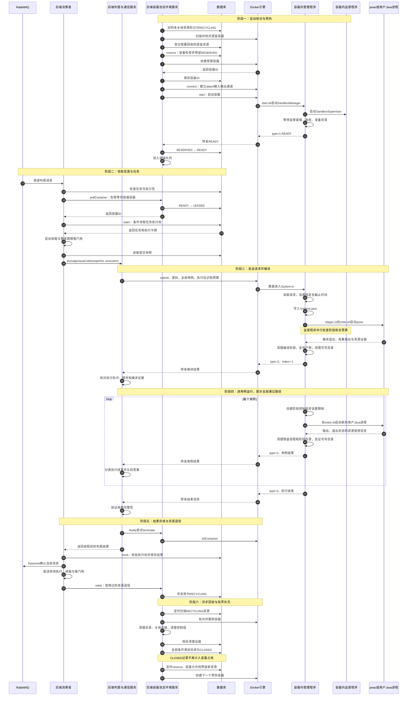

# 阅读亮点7代码执行链路+时序图

本文整理本次代码阅读中核对的执行链路。项目路径：`E:\算法擂台\online-judge\Online-Judge`。任务领取和结果落库属于与亮点6的衔接，一并列出以明确入口和出口。本文是代码阅读整理，不代表实际运行验证已通过。

## 一、执行流程

### 1. 后端启动：核对旧资源，准备新的执行环境

入口是 `DockerSandBoxPool.initDockerPool()`：

- 将当前 worker 尚未关闭的旧资源标记为 `RECYCLING`。
- 扫描 Docker 中的容器，接管符合规则的遗留容器。
- 初始化完成后调用 `replenish()`，尝试补充资源。
- 后续由定时任务持续负责回收和补充。

补充资源的调用链：

```text
DockerSandBoxPool.replenish()
    → SandboxResourceServiceImpl.reserve()
    → SandboxEnvironmentServiceImpl.create()
```

`reserve()` 在数据库事务中检查容量并预留资源，状态为 `RESERVED`。达到正常容量或硬容量上限时，不继续创建。

### 2. 创建容器：连接、启动、自检、就绪

`create()` 的主要顺序：

```text
确认资源预留记录
→ 检查运行镜像并记录元数据
→ 创建父控制组
→ 配置容器隔离和资源限制
→ 记录即将请求Docker创建
→ 创建容器，保存容器ID
→ runtime.connect(id)
→ 启动容器
→ 等待READY
→ 检查容器仍在运行
→ 数据库状态改为READY
→ 加入后端就绪队列
```

容器启动后，通过启动脚本运行 `SandboxManager`。管理程序启动独立的 `SandboxSupervisor` 监督进程，完成自检、工作目录准备和清理，然后发送 `type=1` 的 READY 消息，等待后端请求。

**提前准备的是尚未执行用户提交的容器。**

### 3. 消费消息：先拿容器，再争取任务执行权

入口是 `JudgeConsumer.consume()`：

```text
解析并校验消息
→ 检查任务是否仍可执行
→ 在有限等待时间内领取就绪容器
→ 资源状态READY变为LEASED
→ taskService.claim(message)争取任务执行权
```

分支处理：

- 消息无效：拒绝消息。
- 任务已经不需要本次消费：确认消息并返回。
- 一直拿不到容器：暂停消费，之后检查恢复条件。
- 拿到容器但没取得任务执行权：归还尚未使用的容器。

领取成功后，启动后端整体期限看门狗和数据库续租任务，再读取、校验提交快照。

### 4. 后端发送一次完整执行请求

```text
JudgeConsumer.consume()
    → JudgeServiceImpl.doJudgeJavaCode(...)
    → SandboxPoolServiceImpl.exeJavaCode(...)
    → SandboxRuntimeServiceImpl.submit(...)
```

请求包含本次执行标识、源码、用例列表和资源预算。

```text
后端Java进程
→ Docker attach输入通道
→ Docker引擎
→ 管理程序的System.in
```

管理程序通过 `Protocol.request(...)` 读取请求，并建立本次提交的固定总截止时间。

### 5. 管理程序编译一次源码

`SandboxManager.execute()`：

```text
将源码写入/work/case/Solution.java
→ stage(-1, ...)执行编译阶段
→ 创建编译阶段控制组并设置限制
→ StageControl.start(...)
→ enter.sh启动javac
→ 收集标准输出、错误输出和资源证据
→ 清理阶段进程
→ 编译成功后将产物发布到/artifact
→ 清理可写目录
→ 返回编译阶段结果
```

编译阶段使用 `index=-1`。正常编译结果是 `type=2` 消息，**不是编译成功后就发送结束消息**。编译失败等终止路径才会提前结束本次提交。

### 6. 在同一容器中逐个运行用例

每个用例调用一次：

```java
stage(i, arguments, request.cpuMillis, request.memoryBytes)
```

```text
准备工作目录
→ 创建当前用例控制组
→ 设置内存、CPU、进程数等限制
→ enter.sh启动新的Java进程运行Solution
→ 有界收集stdout和stderr
→ 等待进程结束并收集执行证据
→ 清理残留进程和阶段控制组
→ 清理并验证可写目录
→ 发送当前用例结果
```

**编译产物在本次提交中复用，但每个用例启动独立的用户代码执行进程。**

监督程序并行检查阶段期限、CPU预算和提交总预算。管理程序中的守卫线程监视监督进程，防止失去监督后继续执行。

### 7. 后端接收证据、检查顺序、判断答案

正常消息顺序：

```text
type=2，index=-1：编译结果
type=2，index=0 ：第一个用例结果
type=2，index=1 ：第二个用例结果
……
type=3：本次执行结束
```

后端检查：

- 执行标识是否匹配。
- 阶段顺序是否正确。
- 资源超限、退出码和清理证据是否有效。
- 实际输出与预期输出是否一致。
- 收到结束消息时，用例结果是否完整。

后端发现执行失败或答案错误时，可以提前返回失败结果，不必等待全部用例完成。

`SandboxPoolServiceImpl` 的接收处理块退出时，在 `finally` 中尝试终止容器。

### 8. 保存结果，并将使用过的资源退役

`JudgeServiceImpl` 装配业务结果后返回消费者。正常完成路径：

```text
确认本次执行仍有效
→ taskService.finish(...)条件提交结果
→ ACK当前消息
→ finally取消本地执行标志、看门狗和续租任务
→ dockerPool.retire(...)
```

退役使资源进入 `RECYCLING`，不再供下一份提交使用。

```text
terminate：尝试停止容器运行
retire：登记为待回收，不再借出
recycle：实际删除容器并清理附属资源
```

### 9. 后台回收，确认后释放占用

定时调用：

```text
recoverRetired()
    → SandboxEnvironmentServiceImpl.recycle(resource)
```

回收过程：

```text
核对容器身份或创建结果
→ 删除容器
→ 清理后端对应目录
→ 关闭通信连接
→ 清理对应控制组
→ 保存各项清理完成证据
→ 满足关闭条件后改为CLOSED
```

失败或结果不确定时，保留未关闭记录，后续继续核对与回收。

资源变成 `CLOSED` 后，下次容量查询不再统计它，才体现为占用释放。补池仍受正常容量和硬容量限制；有硬容量余量时，也可能在旧资源回收期间补充新资源。

## 二、主要代码入口

- [JudgeConsumer.java](E:/算法擂台/online-judge/Online-Judge/oj-modules/oj-judge/src/main/java/org/example/judge/rabbit/JudgeConsumer.java)
- [DockerSandBoxPool.java](E:/算法擂台/online-judge/Online-Judge/oj-modules/oj-judge/src/main/java/org/example/judge/config/DockerSandBoxPool.java)
- [SandboxEnvironmentServiceImpl.java](E:/算法擂台/online-judge/Online-Judge/oj-modules/oj-judge/src/main/java/org/example/judge/service/impl/SandboxEnvironmentServiceImpl.java)
- [SandboxPoolServiceImpl.java](E:/算法擂台/online-judge/Online-Judge/oj-modules/oj-judge/src/main/java/org/example/judge/service/impl/SandboxPoolServiceImpl.java)
- [SandboxManager.java](E:/算法擂台/online-judge/Online-Judge/sandbox-runtime/src/SandboxManager.java)

## 三、整体时序图

下面以正常执行完成为主线；请求和结果都经过 Docker attach 通道，后端与管理程序不是直接调用 Java 方法。支持 Mermaid 的 Markdown 预览器可以渲染此图。



## 四、主要异常出口

| 异常 | 处理方向 |
|---|---|
| 等不到就绪容器 | 暂停消费，定时检查恢复条件 |
| 已拿容器但任务领取失败 | 归还未使用容器 |
| 编译失败、超限、运行错误、答案错误 | 提前形成失败结果，终止本次环境 |
| 续租失败或后端整体期限到达 | 取消执行、打断执行线程、尝试终止并退役容器 |
| 监督程序异常退出 | 容器内兜底停止受控执行 |
| 删除或清理未确认 | 保留资源占用，后续重试回收 |
| 后端重启 | 扫描数据库和Docker，将遗留资源重新接入回收 |
